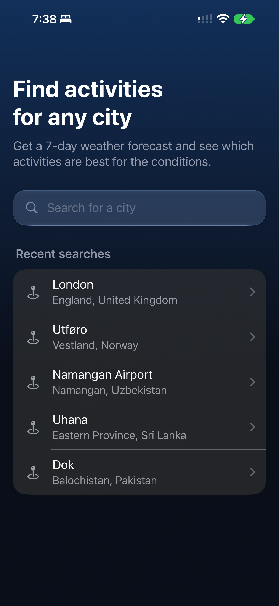
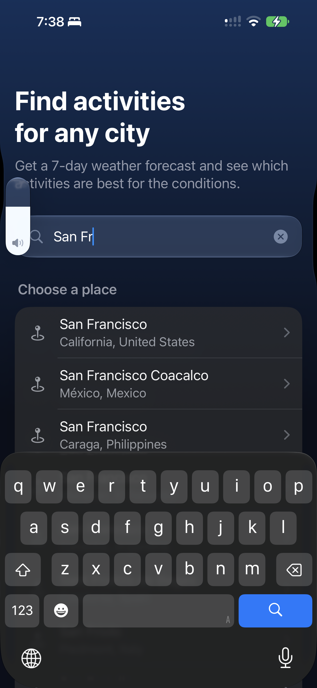
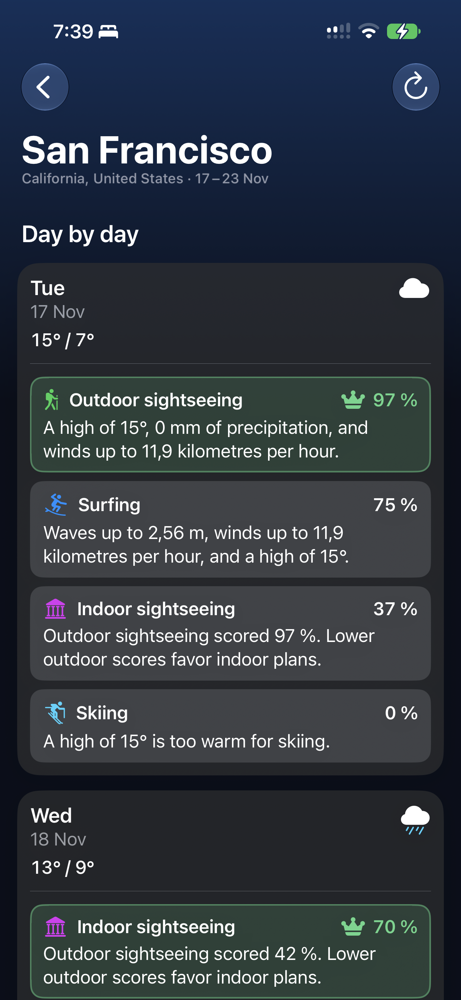

# Weather Activities

Search for a city and see how skiing, surfing, outdoor sightseeing and indoor sightseeing rank on each day of its seven-day forecast. The app runs on iPhone and iPad and gets its weather from [Open-Meteo](https://open-meteo.com/).

[Build and run](#d-how-to-build-and-run) · [Run tests](#e-how-to-run-tests-and-testing-strategy)

## a. Project overview

### Recent searches

[](docs/screenshots/search-recents.png)

Tap a recent place to reopen its forecast, or type a city name to look up somewhere new. The app remembers the last five places you opened.

### Search results

[](docs/screenshots/search-results.png)

The app starts looking for matches after two characters. Check the region and country to pick the right place, then tap it to open the forecast. The keyboard's search button submits immediately.

### Daily forecast

[](docs/screenshots/daily-forecast.png)

Scroll through the week to see each day's weather, high and low temperatures, and four activity scores with their reasons. A crown marks the highest score. When a measurement is missing, such as wave height, the entry shows “No score” and explains why.

Pull down or tap the refresh button to update the forecast. If the refresh fails, the current forecast stays visible with a Try Again button. VoiceOver reads the date and weather before the activity entries. At accessibility text sizes, the name and score stack so the explanation has room to wrap.

## b. Platform and tooling

| Choice | Notes |
|---|---|
| iOS 27.0+, Xcode 27.1 | iPhone and iPad |
| Swift 6 language mode | Strict concurrency checking. `SWIFT_DEFAULT_ACTOR_ISOLATION = MainActor` and approachable concurrency on the app target |
| SwiftUI + Observation | `@Observable` view models, `NavigationStack` |
| Swift Concurrency | `async`/`await`, `async let`, task cancellation. No Combine |
| Swift Testing for unit tests | See below |
| XCTest for the UI test | `XCUIApplication` is only available in XCTest |
| No third-party dependencies | Nothing to resolve or keep updated |

I chose Swift Testing for the unit tests. `@Test(arguments:)` lets the same test cover several API failures and malformed responses. `#expect` and `#require` show which values failed. XCTest runs the launch smoke test through the same Xcode scheme.

## c. Architecture and technical decisions

The `App` layer wires the app together at launch through `AppDependencies.live()`. The search and forecast view models take `GeocodingRepository` and `WeatherRepository` through their initialisers. `RecentLocationsStore` uses an injected `UserDefaults` instance. The search view model uses that store directly.

`Data` sends requests, decodes Open-Meteo responses and maps them into `Domain` models. `ActivityRecommendationService` is a pure function of the forecast. It returns a score and a typed reason for each activity, and SwiftUI turns the reason into display text.

Each screen uses `switch` to render an explicit state. `SearchState` covers idle, searching, results, empty and failure. `ForecastState` carries a `RefreshStatus` when a forecast is loaded, so an error during refresh can keep the previous content on screen.

Search waits 300 ms after typing, cancels the previous lookup when the query changes and discards cancelled results. `ForecastViewModel` shares one in-flight request guard across load, retry and refresh, and restores the previous state on cancellation. `OpenMeteoClient.get` uses `@concurrent` to run networking and decoding off the main actor. `OpenMeteoWeatherRepository` fetches weather and waves in parallel with `async let`.

`RepositoryError` gives the screens a small set of failures to display. The initial error screen offers a retry. A failed Marine API request leaves wave data unavailable. The client maps `URLError.cancelled` to `CancellationError`, so cancellation propagates through both requests.

<details>
<summary>Source layout, screen states and error mapping</summary>

The app target defaults to `MainActor` isolation. `Domain` imports Foundation. Types that cross actor boundaries in `Domain` and `Data` are `nonisolated` and `Sendable`. Leaving the forecast screen cancels its initial `.task`.

```
weather-activities/
├── App/              Entry point, RootView (navigation), AppDependencies (composition root)
├── Presentation/
│   ├── Search/       SearchViewModel, SearchScreen and its subviews
│   ├── Forecast/     ForecastViewModel, ForecastScreen, day cards, activity explanations, refresh banner
│   ├── Shared/       Domain → UI mapping: names, SF Symbols, error messages, location detail
│   └── DesignSystem/ Card surface, sky background, error state view, format styles
├── Domain/           Models, ActivityRecommendationService, repository protocols, RepositoryError
├── Data/
│   ├── Networking/   HTTPTransport, OpenMeteoClient
│   ├── Geocoding/    OpenMeteoGeocodingRepository and its DTO
│   ├── Weather/      OpenMeteoWeatherRepository, DTOs, ForecastMapper, WMO code mapping
│   └── RecentLocationsStore.swift
└── PreviewSupport/   Stub repositories and sample data for SwiftUI previews
```

```swift
enum SearchState {
    case idle                      // query < 2 characters: show recent searches
    case searching
    case results([Location])
    case empty(query: String)
    case failed(RepositoryError)
}

enum ForecastState {
    case loading
    case loaded(ForecastContent, refresh: RefreshStatus)  // content stays visible during and after a refresh
    case empty
    case failed(RepositoryError)
}

enum RefreshStatus { case idle, refreshing, failed(RepositoryError) }
```

| Case | Cause | Shown as |
|---|---|---|
| `connectivity` | No response: offline, timeout, DNS | "No Connection" |
| `httpStatus(Int)` | Non-2xx status | "Service Unavailable", with the status code |
| `decoding` | Body doesn't match the expected JSON | "Unexpected Data" |
| `malformedForecast` | Decoded but inconsistent: unknown time zone, unparseable date, uneven arrays | "Unexpected Data" |

</details>

## d. How to build and run

1. Open `weather-activities.xcodeproj` in Xcode 27.1 or later.
2. Select the `weather-activities` scheme and an iOS 27 simulator.
3. Press ⌘R.

For a physical device, select your own team in **Signing & Capabilities** and change the bundle identifier if needed. The project builds without an API key, a backend or third-party packages.

## e. How to run tests and testing strategy

Press ⌘U in Xcode, or run `xcodebuild test` from the repository root.

```sh
xcodebuild test \
  -project weather-activities.xcodeproj \
  -scheme weather-activities \
  -destination 'platform=iOS Simulator,name=iPhone Duo'
```

Replace `iPhone Duo` with an installed iOS 27 simulator from `xcrun simctl list devices`. The suite runs offline.

`ScriptedGeocodingRepository` and `ScriptedWeatherRepository` exercise view model transitions. `ControlledGeocodingRepository` delivers responses out of order to test stale search results. Forecast tests hold a request open to check overlapping actions and cancellation.

`StubTransport` replaces `HTTPTransport` so tests can check request parameters and run the real decoding and mapping code against Open-Meteo responses captured on 2026-11-17. The `ForecastJSON` and `MarineJSON` builders let tests inject `null` or malformed data. `IsolatedDefaults` gives each persistence test its own suite.

The UI test covers launch. SwiftUI previews cover the search and forecast states, including coastal and inland locations, dark mode and accessibility text sizes.

<details>
<summary>Test coverage by suite</summary>

| Suite | Covers |
|---|---|
| `ActivityRecommendationServiceTests` | Activity ranking, score range and tie order, forecast order, and reasons for weather inputs, cutoffs, penalties, and missing data |
| `ForecastViewModelTests` | Load, failure then retry, refresh success and failure, overlapping actions, cancellation, empty forecast |
| `SearchViewModelTests` | Minimum length (including whitespace), results, empty and failure, retry, clearing returns to idle, debounce (only the final query is searched), Return skips the debounce, stale responses ignored, recent searches |
| `OpenMeteoGeocodingRepositoryTests` | Mapping live JSON, missing region, missing `results` key, query encoding, HTTP/connectivity/decoding failures, cancellation |
| `OpenMeteoWeatherRepositoryTests` | With `ForecastMapper`: dates are midnights in the city's time zone, live values, `null`s stay `nil`, incomplete days skipped, 4 kinds of malformed forecast, HTTP failure, waves matched by date, every kind of unusable marine response means no waves, a cancelled marine request cancels the whole fetch, exact request parameters |
| `RecentLocationsStoreTests` | Order, de-duplication, capacity, persistence across instances, same name with different IDs, unreadable data |
| `LaunchUITests` (XCTest) | The app launches to the search screen |

</details>

## f. API usage notes

| Endpoint | Purpose | Parameters |
|---|---|---|
| `https://geocoding-api.open-meteo.com/v1/search` | City search | `name`, `count=10`, `language=<device language>`, `format=json` |
| `https://api.open-meteo.com/v1/forecast` | Daily forecast | `latitude`, `longitude`, `daily=weather_code,temperature_2m_max,temperature_2m_min,precipitation_sum,snowfall_sum,wind_speed_10m_max`, `timezone=auto`, `forecast_days=7` |
| `https://marine-api.open-meteo.com/v1/marine` | Wave heights | `latitude`, `longitude`, `daily=wave_height_max`, `timezone=auto`, `forecast_days=7` |

Both weather requests use the selected location's coordinates. I added the Marine API for wave height, which surfing needs. The mapper matches waves to forecast days by local date. It skips days with a missing or unknown weather code or a missing high or low. Missing scoring inputs stay `nil`. A response with zero usable days shows the empty state.

Scores use °C, mm of precipitation, cm of snowfall, km/h of wind and m of wave height. In the saved API responses, a search with zero matches omits `results`, and the inland Chamonix response returns HTTP 200 with `null` for every `wave_height_max`.

The app uses Open-Meteo's free non-commercial API, with fewer than 10,000 calls per day under its terms. [Open-Meteo terms](https://open-meteo.com/en/terms)

The app still needs in-app attribution for Open-Meteo and the providers of the models it uses. [Marine API provider credits](https://open-meteo.com/en/docs/marine-weather-api#citation--acknowledgement)

## g. Activity recommendation logic

Each activity gets a score from 0 to 1. The forecast displays it as a percentage. [`Domain/ActivityRecommendationService.swift`](weather-activities/Domain/ActivityRecommendationService.swift)

- Outdoor sightseeing favours comfortable temperatures, dry weather and lighter wind. Fog and thunderstorms lower the score.
- Indoor sightseeing scores higher when the outdoor score is low.
- Surfing weighs maximum wave height, wind and warmth. A thunderstorm gives it a score of zero when the required measurements are available.
- Skiing favours cold days and fresh snow. A high of 8 °C or above gives it a score of zero when snowfall data is available.

Unscored activities sort after scored ones. Swift's stable `sorted(by:)` keeps ties in declaration order (surfing, outdoor sightseeing, indoor sightseeing, skiing).

### Worked example

Take a partly cloudy day in San Francisco with a high of 18 °C, zero rain, 14 km/h wind and 1.6 m waves.

- Outdoor sightseeing gets **1.00** because comfort, dryness and calm each score 1.
- Surfing gets **0.92**. The wave and calm factors are both 1, and the temperature factor is `0.5 + 0.5 × 0.83`.
- Indoor sightseeing gets **0.35** from `0.35 + 0.6 × 0`.
- Skiing gets **0** because the cold factor is 0.

<details>
<summary>Exact scoring formulas and WMO codes</summary>

### The `ramp` helper

```
ramp(value, from: a, to: b) = clamp((value − a) / (b − a), 0, 1)
```

The ramp is 0 at `a`, 1 at `b` and linear in between. A descending ramp gives lower values more weight.

### Outdoor sightseeing (needs precipitation and wind)

| Factor | Formula | Meaning |
|---|---|---|
| comfort | `min(ramp(high, 5 → 16), ramp(high, 34 → 26))` | 1 from 16 to 26 °C; 0 at 5 °C or below and 34 °C or above |
| dry | `ramp(precipitation, 10 → 0)` | 1 when dry; 0 at 10 mm or more |
| calm | `ramp(wind, 50 → 20)` | 1 at 20 km/h or less; 0 at 50 km/h or more |

`score = 0.45 × comfort + 0.4 × dry + 0.15 × calm`, then ×0.8 in fog and ×0.3 in a thunderstorm.

### Indoor sightseeing

`score = 0.35 + 0.6 × (1 − outdoor sightseeing)` ranges from **0.35** on an ideal day outdoors to **0.95** when the outdoor score is zero. The indoor score is `nil` whenever the outdoor score is `nil`.

### Surfing (needs wave height and wind)

With wave and wind data available, a thunderstorm gives surfing a score of **0**.

| Factor | Formula | Meaning |
|---|---|---|
| waves | `min(ramp(wave, 0.3 → 1), ramp(wave, 3.5 → 2.5))` | 1 from 1 to 2.5 m; flat at 0.3 m or less, too big at 3.5 m or more |
| calm | `ramp(wind, 40 → 15)` | 1 at 15 km/h or less; 0 at 40 km/h or more |
| warm | `ramp(high, 8 → 20)` | 1 at 20 °C or more; 0 at 8 °C or less |

`score = waves × (0.6 + 0.4 × calm) × (0.5 + 0.5 × warm)`. The wave factor can bring the score to zero. Wind can reduce it by up to 40%, and temperature by up to 50%.

### Skiing (needs snowfall)

| Factor | Formula | Meaning |
|---|---|---|
| cold | `ramp(high, 8 → 0)` | 1 at 0 °C or below; 0 at 8 °C or above |
| fresh snow | `ramp(snowfall, 0 → 10)` | 1 at 10 cm or more of new snow |

`score = cold × (0.3 + 0.7 × fresh snow)`

### Weather conditions (WMO codes)

| Codes | Condition |
|---|---|
| 0 | Clear |
| 1, 2 | Partly cloudy |
| 3 | Overcast |
| 45, 48 | Fog |
| 51–57 | Drizzle |
| 61–67, 80–82 | Rain |
| 71–77, 85, 86 | Snow |
| 95–99 | Thunderstorm |

Only fog and thunderstorms change the score. The other conditions are for display.

</details>

## h. Assumptions

I rank activities separately for each day because the best option can change during the week. The forecast uses the city's time zone, and geocoding asks for place names in the device language.

The daily high stands in for daytime temperature. I use fresh snowfall as a proxy for ski conditions, which also depend on snow depth and slope elevation. A freezing day with zero new snow still scores 0.3. For surfing, I use the Marine API's grid cell for the city's coordinates as a proxy for nearby surf. In the San Francisco fixture, the grid cell is about 4 km from the city.

## i. Trade-offs and omissions

I limited search to 10 results to keep similar place names easy to scan. Daily summaries keep the scoring simple to explain and test. A dry morning and a wet afternoon still get a single ranking. The scoring thresholds are hand-tuned.

Fetching a forecast requires a connection. I dropped an in-memory cache because it added more code and tests than it saved at this scale.

The app ships in English, with localisable copy using `LocalizedStringResource`, `String(localized:)` and SwiftUI. It uses Liquid Glass APIs introduced in iOS 26 and targets iOS 27, where I tested it.

## j. Production-readiness notes

- Persist the last forecast for each place and show when it was fetched so it can be used offline.
- Add the data credits described in the API notes. For commercial use, choose an Open-Meteo paid plan or self-host the API. Add a privacy manifest for the app's use of `UserDefaults` (`CA92.1`). [Apple's privacy manifest technote](https://developer.apple.com/documentation/technotes/tn3183-adding-required-reason-api-entries-to-your-privacy-manifest)
- Set request timeouts and use exponential backoff for connectivity errors and 5xx responses. Add `os.Logger`, crash reporting and API failure metrics.
- Run builds and tests in CI with SwiftLint and SwiftFormat. Add snapshots, a live API contract check and a UI flow test with stubs selected at launch.
- Add a String Catalog and translations. Make scoring thresholds configurable without an app release.

## k. Cross-platform delivery notes

On Android, I'd use Jetpack Compose for the screens and a `ViewModel` with `StateFlow` for each screen's state. Repository interfaces would keep scoring and presentation independent of the HTTP client.

At this size, I'd keep both apps native and share the scoring spec, API fixtures and test vectors with expected scores and rankings. Running the same vectors on both platforms would catch differences in the recommendations. I'd revisit Kotlin Multiplatform if sharing the Domain and Data code justified the extra toolchain.

<details>
<summary>Android equivalents</summary>

| iOS | Android |
|---|---|
| SwiftUI | Jetpack Compose |
| `@Observable` view model with a state enum | `ViewModel` exposing `StateFlow` of a sealed state class |
| Debounce and cancel in `SearchViewModel` | Flow `debounce` + `flatMapLatest` |
| `OpenMeteoClient` + `Codable` DTOs | Ktor or Retrofit + kotlinx.serialization |
| Repository protocols | Repository interfaces |
| `AppDependencies` | Hilt, or the same manual DI |
| `RecentLocationsStore` (`UserDefaults`) | DataStore |
| Swift Testing + test doubles | JUnit + Turbine (+ fakes) |

</details>

## l. AI usage disclosure

I used Claude Code to implement SwiftUI interfaces, API layer, tests, and first draft of the README. All Source code verified and tested by me on physical device and simulator